<!-- Profile README for github.com/inernoro. Visual assets are stored in this repository. -->

  

  <strong>把想法做成产品，把复杂留给工程。</strong> 
  AI 产品 · 全栈应用 · 开发者工具

  <a href="#selected-work">精选项目</a> &nbsp; / &nbsp;
  <a href="#engineering">工程方法</a> &nbsp; / &nbsp;
  <a href="#toolbox">技术工具箱</a> &nbsp; / &nbsp;
  <a href="https://github.com/inernoro?tab=repositories">全部仓库 ↗</a>

我是 **InerNoro**。这里记录我在 AI 产品、全栈应用与工程工具上的实践：从产品知识与 Agent 工作流，到模型路由、品牌视觉生成和部署预览。喜欢把一条链路做通，也关心系统运行之后，如何观察、核验与改进。

## Selected work

<table>
  <tr>
    <td width="50%" valign="top"></td>
    <td width="50%" valign="top"></td>
  </tr>
  <tr>
    <td width="50%" valign="top"></td>
    <td width="50%" valign="top"></td>
  </tr>
</table>

<a href="https://inernoro.github.io/vlm_price/">打开 AI Price Board 在线看板 ↗</a>

## How I approach engineering

| 关注点 | 项目中的实践 |
| :--- | :--- |
| **完整链路** | PRD Agent 将知识工作台、Agent 工作流、模型网关与分支预览纳入同一工程体系。 |
| **明确边界** | OpenVisual 用共享契约描述数据与接口，通过 Provider 适配层组织 AI 服务。 |
| **可核验证据** | AI Price Board 分开记录目录预算与实验实付，保留来源、公式与核验时间。 |
| **可观察行为** | Redis Monitor 把命令流整理为数据库、命令、Key 与客户端等维度的活动排行。 |

## Toolbox

公开项目中使用的技术：

**应用与交互** &nbsp; `TypeScript` · `React` · `Next.js` · `Tauri`  
**服务与工具** &nbsp; `C# / .NET` · `Python / FastAPI` · `Go`  
**数据与交付** &nbsp; `MongoDB` · `PostgreSQL` · `Redis` · `Docker` · `GitHub Actions`

还有一点有趣的东西

除了工程，也给桌面做了一只圆滚滚的熊猫：**[Panda Bun](https://github.com/inernoro/panda-bun-pet)**，一只带动画精灵图的 Codex 宠物。

 

