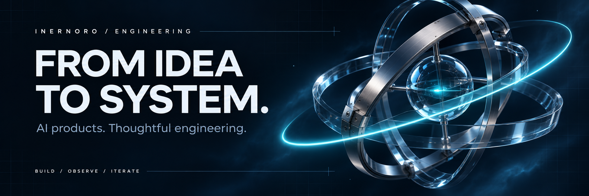
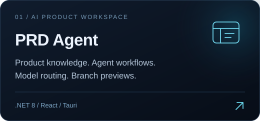
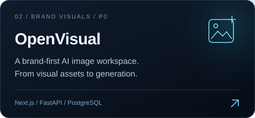
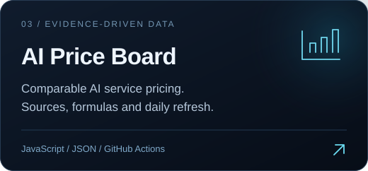
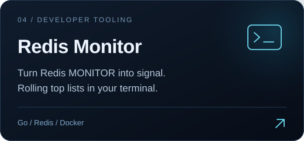
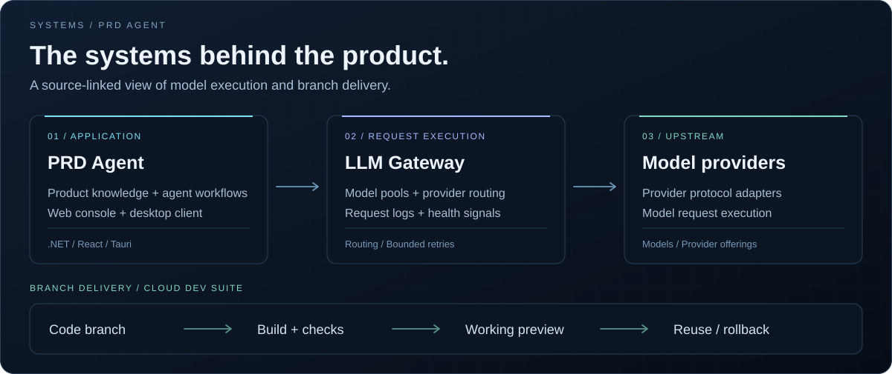
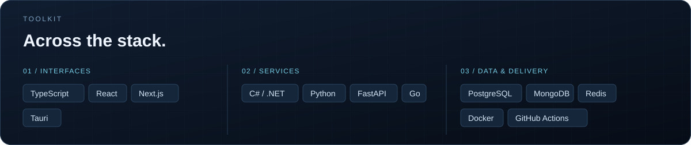
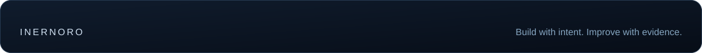

<!-- Original artwork and project illustrations are stored in this repository. -->

  

  <strong>I build AI products — and the systems behind them.</strong> 
  Product interfaces · Agent workflows · Model infrastructure

  <samp>
    <a href="#selected-work">work</a> &nbsp; / &nbsp;
    <a href="#inside-the-systems">systems</a> &nbsp; / &nbsp;
    <a href="#toolkit">toolkit</a> &nbsp; / &nbsp;
    <a href="https://github.com/inernoro?tab=repositories">all repositories</a>
  </samp>

I'm **InerNoro**. My work spans AI workspaces, model gateways, visual generation, and developer tools. I like connecting the pieces: the interface people use, the services behind it, and the path from a code change to a working preview.

## Selected work

<table>
  <tr>
    <td width="50%" valign="top"></td>
    <td width="50%" valign="top"></td>
  </tr>
  <tr>
    <td width="50%" valign="top"></td>
    <td width="50%" valign="top"></td>
  </tr>
</table>

<samp><a href="https://inernoro.github.io/vlm_price/">try AI Price Board</a> &nbsp; / &nbsp; <a href="https://github.com/inernoro/vlm_price/blob/main/docs/03-%E6%B5%8B%E8%AF%95%E6%96%B9%E6%B3%95%E4%B8%8E%E5%8E%9F%E5%A7%8B%E7%BB%93%E6%9E%9C.md">inspect the benchmark evidence</a></samp>

## Inside the systems

<picture>
  <source media="(max-width: 640px)" srcset="./assets/systems-mobile.svg" />
  
</picture>

  <samp>
    <a href="https://github.com/inernoro/prd_agent">explore the workspace</a> &nbsp; / &nbsp;
    <a href="https://github.com/inernoro/prd_agent/blob/main/doc/design.platform.llm-gateway.md">gateway design</a> &nbsp; / &nbsp;
    <a href="https://github.com/inernoro/prd_agent/tree/main/cds">branch delivery</a>
  </samp>

## Toolkit

<picture>
  <source media="(max-width: 640px)" srcset="./assets/toolkit-mobile.svg" />
  
</picture>

 

  Sometimes the next build is a <a href="https://github.com/inernoro/panda-bun-pet">tiny desktop panda</a>.

